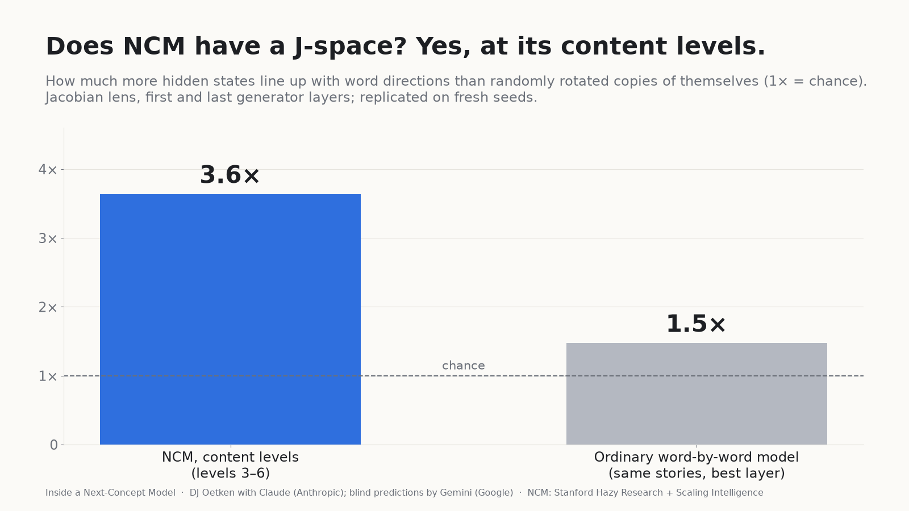
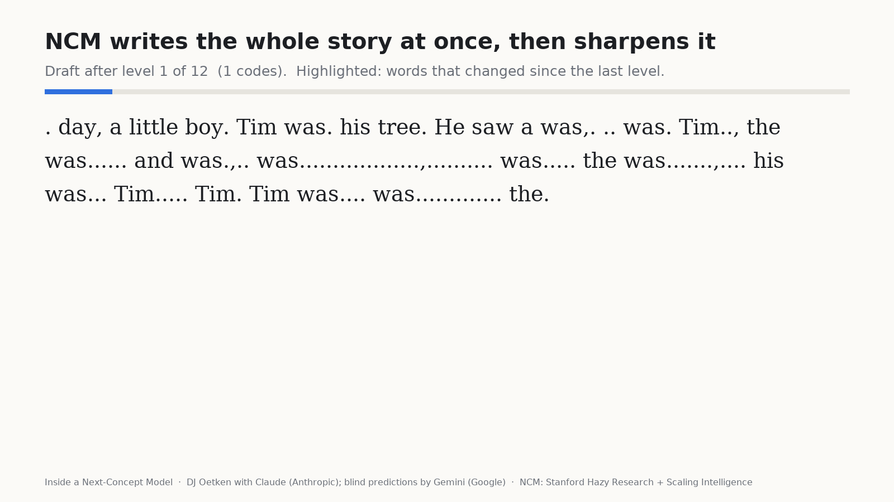
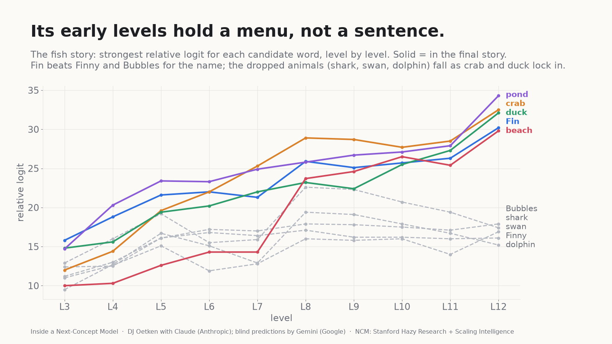
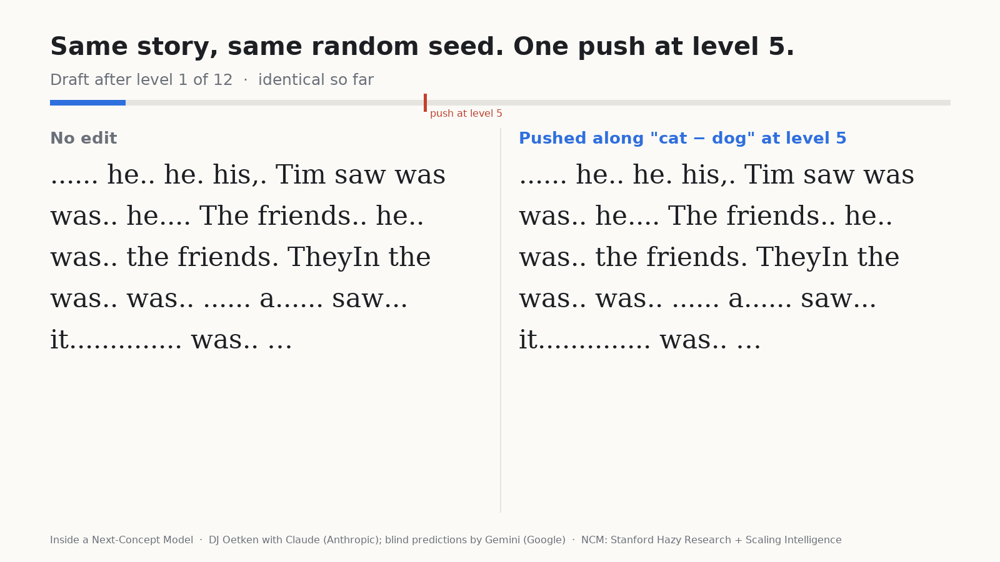
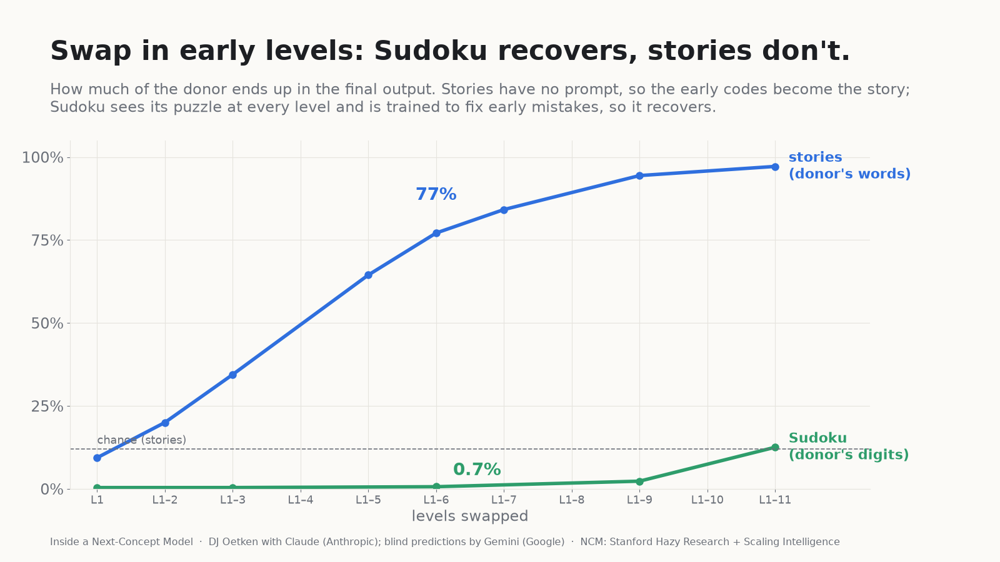
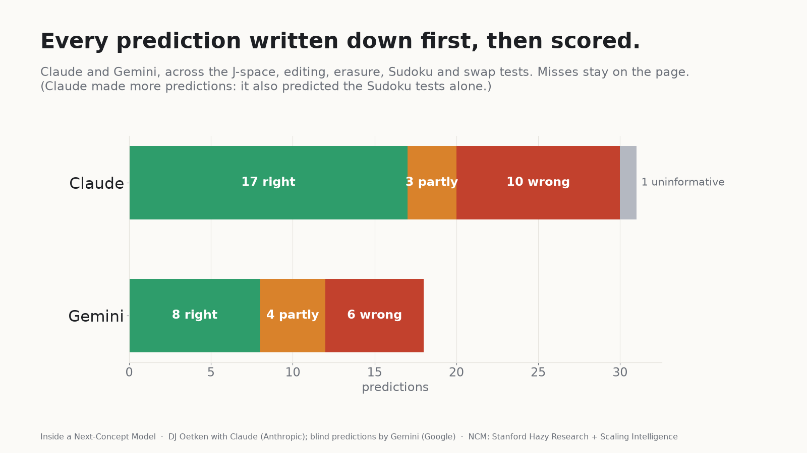

# Inside a Next-Concept Model

Interpretability experiments on [Next-Concept Modeling (NCM)](https://hazyresearch.stanford.edu/blog/2026-10-12-ncm),
from Stanford's [Hazy Research](https://hazyresearch.stanford.edu/) and
[Scaling Intelligence](https://scalingintelligence.stanford.edu/) labs
([paper](https://arxiv.org/abs/2610.14162), [code](https://github.com/HazyResearch/ncm)),
run on one consumer GPU.

**Full write-up, with interactive charts:** https://claude.ai/artifact/M4jio6cZueHvEWk3nZK3Ka
(a copy is in [`docs/index.html`](docs/index.html)).

**Who did what.** DJ Oetken chose the questions and directed the work. Claude (Anthropic) wrote and ran the code
and wrote the write-up. Gemini (Google) made blind predictions before results were in. Both models' predictions are
scored, misses included, in [`probe/HYPOTHESES.md`](probe/HYPOTHESES.md), which records each prediction as it was
written before the data.

## Highlights

### NCM has a J-space, in a different place

A Jacobian lens (after Anthropic's J-space work) on NCM's TinyStories model and on an ordinary word-by-word model
trained on the same stories. NCM's content levels line up with word directions about 3.6x more than chance; the
ordinary model peaks around 1.5x. Replicated on fresh seeds.

### It writes the whole story at once, then sharpens it

The model's own drafts, decoded after each of its 12 levels. Highlighted: words that changed since the last level.

### Its early levels hold a menu, not a sentence

Fin, Finny and Bubbles compete for the hero's name; the options the story drops are pushed down, not just left behind.

### One push at level 5 turns a dog story into a cat story

Same story, same random seed. Pushing along the lens's "cat minus dog" direction at level 5 rewrites the world
around it: a girl walking her dog Max becomes a cat named Mimi walking her cat Luna. Across 64 stories, 98% become cat
stories; a random push of the same size changes about as much text but never adds a cat.

### Swap in another example's early levels: Sudoku recovers, stories don't

Sudoku sees its puzzle at every level, and NCM is trained with conditioning corruption so later levels can fix early
mistakes, so a swapped-in coarse plan is mostly overridden (72% of hard puzzles still solved, vs 84%). The story model
has no prompt, so there the early codes become the story.

### Every prediction written down first, then scored

## What's in the repo

| Path | What |
|---|---|
| [`probe/`](probe/) | The experiment scripts, the lab notebook, and the scripts that draw the images. See [`probe/README.md`](probe/README.md). |
| [`probe/results_page/`](probe/results_page/) | The data behind every chart (JSON). |
| [`docs/`](docs/) | A copy of the write-up as a plain web page. |
| [`media/`](media/) | The images and animations above, plus MP4 versions of the animations. |

## Running it

The scripts in [`probe/`](probe/) run against a clone of [HazyResearch/ncm](https://github.com/HazyResearch/ncm)
(tested at commit `c702742`): copy `probe/` into the repo root and run from there. Checkpoints come from
`hazyresearch/ncm-checkpoints`, the control model from `roneneldan/TinyStories-33M`, and the Sudoku puzzles from
`hazyresearch/ncm-datasets`. See [`probe/README.md`](probe/README.md) for the folder layout, the environment
variables, and one command per experiment.

Thanks to the NCM team for releasing the weights and for answering questions.

MIT License (see [`LICENSE`](LICENSE)).
